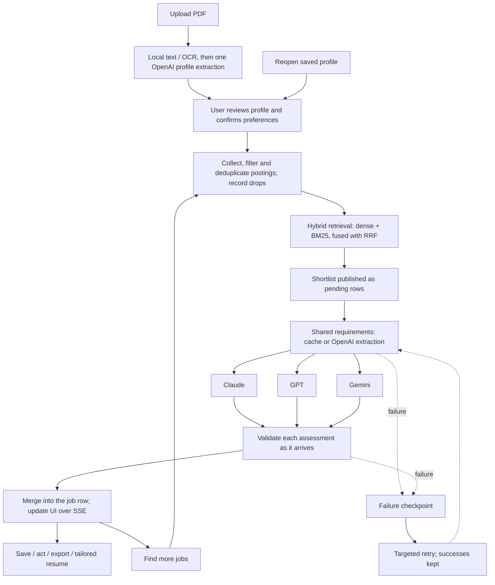

# Architecture

How Career Tracker works, from resume upload to evaluated results. Checked against
the code on 17 November 2026. Setup and commands are in [DEVELOPMENT.md](DEVELOPMENT.md);
why things are the way they are is in [DECISIONS.md](DECISIONS.md).

## Overview

After shortlisting, the diagram is one posting's path; postings move through it
independently. An [animated flowchart](images/application-workflow-flowchart.html)
([GIF](images/application-workflow-flowchart.gif)) also exists, but it predates
30 October 2026 and still shows the old computed score as the verdict.

| Component | Responsibility | Code |
| --- | --- | --- |
| Vue 3 + TypeScript, Pinia, Tailwind | Screens, preferences, results, job actions | `frontend/src/` |
| FastAPI routers | Validate HTTP requests, delegate to handlers | `backend/app.py`, `backend/routers/` |
| Profiles | PDF/OCR, profile extraction, saved profiles, tailored resume | `backend/profiles/` |
| Search | Collection, filters, indexing, retrieval, ranking | `backend/search/` |
| Evaluation | Shared requirements, providers, validation, retries | `backend/evaluation/` |
| Run state | Workers, locks, cancellation, snapshots, retention | `backend/runs.py`, `backend/runs_api.py` |
| Schemas | Pydantic contracts (source of `frontend/openapi.json`) | `backend/schemas/` |

The backend must run as **one Uvicorn worker**: active runs, locks and cancellation
flags live in process memory. Work is still concurrent inside that process (thread
pools for collection and provider calls). POST and PUT requests are limited to 30
per minute per client address (HTTP 429). There are no user accounts: saved profiles
are server-wide and run URLs act as private capabilities.

## 1. Upload and profile extraction

Code: [upload.py](../backend/profiles/upload.py), [extraction.py](../backend/profiles/extraction.py).

`POST /api/resumes/upload` checks the filename, content type, PDF signature and
content: at most 5 MB and 1–20 pages; encrypted, unreadable and oversized-page PDFs
are rejected. Text is extracted locally; scanned pages use Tesseract OCR locally
(`OCR_LANGUAGES`). OpenAI then classifies the document and extracts the profile in
one structured request (`OPENAI_UPLOAD_MODEL`, else `OPENAI_PROFILE_MODEL`, default
`gpt-6.1-sol` at low reasoning). Extraction is OpenAI only; there is no selector.

Responses: 201 with the run ID; 400/413/422 for invalid or non-resume documents;
503 for provider or structured-output failures. A failed upload creates no run and
saves no PDF. A successful upload stays in memory until the first search starts or
the profile is saved, so an abandoned upload never reaches disk and is lost on restart.

The profile lists every resume heading, keeps extra sections (projects,
certifications, volunteering) under their own headings, suggests target roles with
a reason, and records per-entry evidence used by retrieval (type, end date, a
posting-style summary, hard and soft skills). The original resume text is kept with
the profile so evaluators can quote what extraction missed. Projects are evidence
for skills only; academic study and projects never count as professional years.

## 2. Profile review and preferences

Code: [search/service.py](../backend/search/service.py), [profiles/service.py](../backend/profiles/service.py).

The user edits the profile, then picks target roles (at least one), locations
(empty means worldwide; suggestions via Photon), boards (at least one), posting
age, work arrangement, exclusions, seniority and shortlist size. Confirming starts
the search worker; nothing searches before that.

Shortlist (`top_k`): **Automatic** (`-1`, default) evaluates every job when the
indexed pool has at most 200, otherwise the top 100; or 15, 50, 100, or all (`0`).
It sets how many jobs are evaluated, not how many each board collects. Saved
preferences keep their stored size.

Seniority defaults to automatic early-career ordering (section 4). Explicit levels
filter by title terms; saved `any` means All levels.

A confirmed search automatically saves the profile, preferences and PDF (also when
no jobs match). Continued workspaces update their saved profile. Once a workspace
has assessments, confirming a changed profile returns 409: start a new search instead.

## 3. Collection

Code: [collection.py](../backend/search/collection.py), [adaptive.py](../backend/search/adaptive.py),
[filters.py](../backend/search/filters.py), [seek.py](../backend/search/seek.py),
[google_jobs.py](../backend/search/google_jobs.py), [locations.py](../backend/search/locations.py).

### Boards

| Board | Collector | Notes |
| --- | --- | --- |
| LinkedIn | JobSpy, `fetch_description=False` | Descriptions come from the app's own detail fetch (cache, title-first selection, budget), 2 s between job pages. The job page's repost date replaces the card date. |
| Indeed | JobSpy, `fetch_description=True` | Inline descriptions. Empty location searches its country indexes. |
| SEEK | Direct collector on `au.seek.com` | Undocumented endpoint; 20 pages max per query, ≥1 s between requests, 30 s timeout, 5 MiB cap, shared cooldown on 403/429, no proxy or bypass. SEEK's terms require written consent for automated scraping. |
| Google Jobs | SerpApi (`SERPAPI_API_KEY`) | Off by default; each page (≤10 jobs) is one paid search. Locations resolved through SerpApi's free Locations API. Australia and New Zealand are unsupported and skipped at no cost. Web collection only. |
| Adzuna | Official API (`ADZUNA_APP_ID`, `ADZUNA_APP_KEY`) | 50 jobs per page; at most `ADZUNA_MAX_REQUESTS` (2) per search. Returns description snippets only. One supported country per search, taken from the location. |

Greenhouse, Lever and Glassdoor were removed; saved preferences drop them.
`JOB_SEARCH_PROVIDER=adzuna` is a separate legacy/CLI path.

### Adaptive web collection

Web searches share one budget across boards, roles and locations:

| Setting | Default | Max |
| --- | ---: | ---: |
| `JOB_COLLECTION_MAX_BATCHES` (collector calls) | 12 | 100 |
| `JOB_COLLECTION_MAX_DETAILS` (app description fetches) | 60 | 500 |
| `JOB_COLLECTION_MAX_CANDIDATES` (eligible pool) | 150 | 1000 |
| `JOB_COLLECTION_MAX_SECONDS` (soft deadline) | 240 | 900 |

1. Visit every board/role combination once before expanding any; then extra
   locations. Native batch sizes: LinkedIn 10, Indeed 20, SEEK 20.
2. Filter early by location, age, exclusions and available work-type/seniority
   evidence; deduplicate against this search and previously collected jobs.
3. Pick small description batches by title overlap, reserving about 25% for
   exploration. Inline and cached text is used before fetching.
4. Expand the streams with the best eligible-unique yield; stop exhausted or
   repeated-page streams. Previously seen full pages can advance so Find more
   reaches new jobs.
5. **Checkpoint:** when rounds end, every waiting card's description is read with
   no detail or time limit (only cancellation or the candidate limit stops it).

Batch counts are collector operations, not HTTP requests; JobSpy paginates and
fetches internally. The time limit is soft. Jobs without a usable description are
dropped. Direct Python/CLI callers keep fixed collection unless they pass `adaptive=True`.

### Filters, deduplication, rate limits

Location matching ([locations.py](../backend/search/locations.py)) normalizes
state/country aliases, includes a curated set of Australian metro suburbs for
capital-city searches, requires multiword places to match completely, and rejects
explicit state/country conflicts. No geocoding. Work arrangement uses structured
type first, then contextual phrases; unknown arrangement fails an explicit filter.
Seniority filters use title word boundaries.

Duplicates merge on canonical URL, or on normalized company/title/location plus
description similarity ≥ 0.95 (descriptions under 100 characters are not merged).

A listing request answered with 429 and no rows is retried once after 30 s; then
the board stops for that search only. There is no cross-search cooldown, so a new
search can retry immediately. Rate limits are logged on the server and shown as a
calm "fewer jobs from some boards" note, never as an error. Other source errors
keep partial results and are shown; **Retry scraping** reruns the failed boards
with the confirmed inputs.

### Ingestion record

Every posting dropped by location, age, a filter, a missing description, a limit
or deduplication is counted by stage, reason and board in the run's
`ingestion.json`, with a bounded sample (120 filtered, 60 description, 60 limit,
50 duplicate; descriptions cut at 6,000 characters). It observes and never
changes eligibility. Cache-hit searches record no drops. Code:
[ingestion_log.py](../backend/search/ingestion_log.py).

## 4. Indexing and retrieval

Code: [shared_index.py](../backend/search/shared_index.py), [ranking.py](../backend/search/ranking.py),
[retrieval.py](../backend/search/retrieval.py), [hyde.py](../backend/search/hyde.py),
[embedding_text.py](../backend/search/embedding_text.py).

**Index.** Postings are embedded with OpenAI `text-embedding-3-small` and stored in
a shared Chroma index (`.cache/job_index/`, HNSW `ef_search=500`). Job text is the
title and description with recognized company-intro, benefits, legal and
application sections removed (heading-based, so some boilerplate can remain);
company and location stay in metadata, and the full posting is restored for
evaluation. Postings are versioned by content; each search saves `job_scope.json`
with its eligible version IDs, and retrieval filters to that scope. Versions unseen
for seven days are removed on later writes. Vectors are cached by model, text
policy and content hash in `.cache/job_embeddings/` (30-day reuse).

**Queries.** `QUERY_BUILDER` chooses how the profile becomes queries:

| Builder | Queries |
| --- | --- |
| `hyde` (default since 12 Nov 2026) | `evidence`, with role titles replaced by up to three model-written job ads (weights 0.4 / 0.35 / 0.25 of the role vote) |
| `evidence` | Role titles, evidence-weighted skill groups, keyword lines, one query per resume entry |
| `skills` | Roles and skill groups only; entries weight the skills they use |
| `legacy` | One query per role, all skills, recent work, other sections |

Votes before normalization: roles 0.5, skills 1, experience 1, soft skills 0; each
family's vote is split among its queries, then all weights sum to 1 (roles 20%,
skills 40%, experience 40% under `evidence`). Defaults live in
`DEFAULT_RETRIEVAL_WEIGHTS`; `RETRIEVAL_WEIGHTS` (JSON) overrides them, and an
invalid value stops retrieval with an error.

- **Entry strength** = recency × type. Recency 1.0 (ongoing or ended within a year),
  0.6 (2–3 years or undated), 0.3 (older). Type: job 1.0; internship, project,
  other 0.8; hackathon, education 0.6.
- **Skill groups:** a listed skill scores 0.5 plus the strength of each entry that
  shows it, ×1.5 when a target role names it. Skills no entry shows and no role
  names are dropped (under `skills`, kept at 0.2). A group's share is the average
  of its kept skills, so long weak lists don't outweigh short strong ones. Each
  group is searched as its extracted 15–35 word job-ad sentence.
- **Keyword lines:** one or two lines of 6–12 skill terms, at the average score of
  the kept skills they name; a line naming none is skipped.
- **Experience:** one query per entry (summary and hard skills), weighted by
  strength × relevance; the top 8 are kept.
- **Skill names** match whole words after light stemming; "Docker (basics)" is
  Docker, "Git/GitHub" counts both sides.
- **HyDE ads** are written from the roles, eight strongest skills, two strongest
  entries, career level and years (`OPENAI_PROFILE_MODEL`). Ads asking for more
  years than the profile has are dropped. They are searched densely only (no
  BM25) and cached in `.cache/hyde_queries/` with no expiry. On failure the role
  titles are used and generation isn't retried for five minutes.

**Fusion.** Every query yields a dense ranking and a BM25 ranking over cleaned job
text. Weighted reciprocal rank fusion (constant 60) adds `weight / (60 + rank)`.
The candidate window is 3 × K (floor 50), or the whole pool when needed. RRF
values are orderings, not probabilities.

**Ordering before top-K.**

1. *Automatic seniority* (early-career profiles: graduate/entry/junior level, or
   ≤ 2 years). For graduate/entry/junior profiles, mid, senior, lead, staff,
   principal, director, head-of, chief and architect titles move down unless the
   title also accepts juniors. For profiles early-career only by years, such a
   title moves down only when the posting states more years than the profile, or
   the title is director, head-of or chief. "Stated years" means a requirement
   phrase such as "5+ years"; company age doesn't count.
2. *Dismissal preferences* (section 7) move matching jobs below the rest.

Both keep relevance order within each group; moved jobs can still fill spare slots.
The shortlist is then published as pending rows before any evaluation finishes.

## 5. Shared requirements

Code: [requirements.py](../backend/evaluation/requirements.py), [schemas/evaluation.py](../backend/schemas/evaluation.py).

Each posting's requirements are extracted once, without the resume, so every model
judges the same list. Policy `requirements-v5`, model `REQUIREMENT_EXTRACTION_MODEL`
(default `gpt-4o-mini`), 90 s timeout, strict JSON schema:

1. Number the posting's lines; the model returns requirements with inclusive
   `source_start`/`source_end` line ranges, section, importance (`must_have`,
   `nice_to_have`, `unclear`) and type.
2. Reject reversed, out-of-range or blank ranges; copy the original lines into
   `job_quote` (the model never writes quote text).
3. Reject empty or duplicate criteria; clear unsupported section labels.
4. Assign source-ordered IDs (`req_001`, …) and freeze the list.

Invalid output gets one correction retry with field-specific feedback; a persistent
failure blocks that posting's assessments (no per-model fallback). Concurrent
providers share one result per posting. Valid results are cached in
`.cache/job_requirements/` for seven days (≤ 1,000 entries), keyed by posting
content, model, prompt, schema and version; no candidate data. Line ranges prove
where a quote came from, not that the summary or importance is right.

## 6. Evaluation

Code: [providers.py](../backend/evaluation/providers.py), [orchestration.py](../backend/evaluation/orchestration.py),
[candidate_fit.py](../backend/evaluation/candidate_fit.py), [evidence.py](../backend/evaluation/evidence.py),
[runtime.py](../backend/evaluation/runtime.py).

**Availability check.** Each search starts one tiny request per model (no resume or
posting text, cached 10 minutes) in the background; evaluation waits at most 20 s
for it. A model with exhausted quota, rejected credentials or an unavailable model
is skipped and listed under "Some models were skipped"; its jobs are saved for
**Retry skipped models**. A retry rechecks only the models it would call. Timeouts
and brief rate limits do not skip a model. `CAREER_EVALUATION_PREFLIGHT=false`
disables the check.

**Providers.** Claude, GPT and Gemini batches run concurrently, each in waves of 15
jobs with its own worker pool. One model's verdict never skips another; no failed
request is sent to a different provider.

| Setting | Claude | GPT | Gemini |
| --- | --- | --- | --- |
| Default model | `claude-sonnet-5-5` | `gpt-6.1-sol` (low reasoning) | `gemini-4-argon` (low thinking) |
| Workers (cap 8) | 4 | 4 | 2 |
| Request timeout | 180 s | 180 s (`GPT_EVALUATION_TIMEOUT_SECONDS`, 30–600) | 90 s |
| SDK retries | 1 | 1 | 0 (shared pacing/backoff, up to 2 app retries) |
| Other | 16,000 output tokens | Strict JSON schema | `GEMINI_EVALUATION_RPM` 0 = no pacing; 3 consecutive 429s stop the batch |

**Assessment.** Each model gets the frozen requirements, the candidate context
(every profile section plus the original resume text), the posting and the
selected roles. It must return exactly one verdict per requirement ID (`met`,
`partial`, `not_met`, `unknown`) with explanation and resume quotes, and keep each
requirement's fields unchanged (compared after Unicode normalization, whitespace
collapsing and straightening quotes/dashes). A requirement the resume doesn't
mention is `not_met` with no quote, which alone does not make a job unsuitable.

Since 30 October 2026 the **model decides the fit category** (`score_method`
`model-decision-v1`) and returns no numeric score. It may set aside a seniority
rule only with a quoted reason in `rule_exception`. The backend still validates
schema, IDs and quotes (job and resume quotes checked against source text; failed
evidence becomes unknown), and still computes the old rubric, but only stores it as
`rubric_score`, `rubric_category`, `rubric_reason` for comparison against labels:

| Importance | Weight | | Verdict | Credit |
| --- | ---: | --- | --- | ---: |
| must_have | 2 | | met | 1 |
| nice_to_have | 1 | | partial | 0.5 |
| unclear | 1 | | unknown / not_met | 0 |

`score = round(100 × Σ weight×credit / Σ weight)`; an evidenced mandatory mismatch
caps at 39 (excluded); strong match needs every mandatory criterion met and ≥ 80;
otherwise review, capped at 79.

Invalid assessments get one retry with safe validation feedback (field paths, no
returned values). A `minimum_professional_years` claim must be backed by a shared
`must_have` quote or be null.

**Combining.** The combined verdict needs every model the job was sent to to agree;
otherwise it is **For review**. Agreement counts are shown separately and are not
confidence. New jobs are ordered by verdict, then shortlist rank (`shortlist_rank`).
Older saved jobs keep their numeric scores (final average with all three scores,
labeled provisional average with two). Assessments from different requirement
lists are never combined.

**Private cache.** Successful assessments are reused for seven days under the saved
profile (or run), ≤ 1,000 entries per owner, keyed by candidate context, roles,
posting, provider/model, prompt, schema and policy. Evidence checks rerun on hits;
failures are never cached; entries are deleted with their owner.

## 7. Results, actions and follow-ups

**Live updates.** The browser follows `GET /api/searches/{id}/progress` (SSE events
`phase_update`, `profile_extracted`, `scrape_progress`, `job_evaluated`,
`run_completed`, `run_failed`, `run_deleted`) and polls the snapshot about every
1.5 s as a repair path. Snapshots are authoritative; reading one never reruns work.

**Results UI.** Grid and table views, filters, sorting, pagination; page, filters
and sort survive a trip to job details (in memory). Verdicts use one shared chip
style ([fitCategory.ts](../frontend/src/utils/fitCategory.ts)). The details page has
Overview, Job description, Evaluation evidence and Tailored resume tabs (`section`
query parameter). Evidence is a compact list per model, sorted not met → partial →
unknown → met (required first), filterable by verdict, with quotes collapsed.
Postings are always labeled unverified. **Date added** is when a job first entered
the workspace.

**Actions.** Save, Dismiss and Applied (`GET/PUT /api/searches/{id}/actions`). Flags
are owned by the saved profile when there is one, otherwise by the run, keyed by
normalized posting URL (≤ 10,000 keys per owner). The browser keeps pending edits
in localStorage and retries on reopen; a stale sync response cannot overwrite a
newer edit.

**Dismissal preferences** ([preferences.py](../backend/search/preferences.py)).
Dismiss takes an optional reason; it affects only the ordering of *future*
shortlists, never fit verdicts, prompts or the shared index.

| Reason | Lower-priority matches | Not inferred |
| --- | --- | --- |
| Role | Same title after case/whitespace normalization | Synonyms, related roles |
| Location | Same stated location after normalization | Suburb → city, unknown locations |
| Seniority | Same explicit title level (graduate, entry, junior, mid, senior) | Unmarked or mixed titles |
| Salary | Stated pay wholly below the user's minimum, same currency (AUD, USD, GBP, EUR, CAD, NZD) and period (hour/year), near a pay label | Bare `$`, open ranges, conversions |
| Other / none | No ranking effect | — |

Title, location and seniority come from the stored job, not the client. Invalid
feedback returns 422 without changing the action; `dismissal: null` clears it;
restoring the job removes it. Feedback follows the saved profile.

**Job-action labeled dataset** ([action_dataset.py](../backend/evaluation/action_dataset.py)).
Every action update syncs `data/evaluation_datasets/<id>/` (`dataset.json`,
`reviews.json`), one per saved profile or run: Applied → `strong_match`; dismissed
for role or seniority → `not_suitable`; other dismissals keep their reason with no
fit label. Undo removes the label; hand-edited labels are never replaced. Errors
are logged after the action is saved. Nothing deletes these folders automatically.

**Tailored resume** ([tailoring.py](../backend/profiles/tailoring.py),
[TailoredResume.vue](../frontend/src/components/TailoredResume.vue)).
`POST /api/searches/{id}/tailored-resume {key}` makes one Claude call
(`CLAUDE_EVALUATION_MODEL`, strict schema) that selects, orders and rewords the
uploaded resume for that posting without adding facts. Skills and figures not
found in the resume text are flagged "Check before sending"; requirements the
resume doesn't show are listed apart. The call runs outside the run lock; the
result is saved as `tailored_resume` on the job row and survives retries. Layout
follows the UNSW Employability resume guide, single-column and ATS-friendly;
Download PDF prints only the sheet with zero page margins.

**Find more jobs** reruns collection (bypassing the collection cache), skips
postings already shortlisted, and appends the new batch; the shortlist size applies
to the new batch only. It notes when nothing about the search is new and the last
search was under an hour ago, and reports how many postings were already present.

**Exports.** CSV and Excel downloads; values longer than Excel's 32,767-character
cell limit continue in extra columns; text is not treated as formulas.

## 8. Failures, retries, cancellation

| Failure | Result | Recovery |
| --- | --- | --- |
| Invalid PDF or classification failure | No run, no saved PDF | Fix the upload |
| Board failure | Other boards continue; error kept | Retry scraping |
| Board rate limit | Board stops for this search; quiet note | New search any time |
| Requirement extraction invalid twice | That posting's assessments fail | Retry failed evaluations |
| Assessment invalid twice | That provider/job fails | Retry failed evaluations |
| Quota, credentials, model access | Model skipped or stopped | Fix configuration, then retry |
| Cancel | Later work and late writes blocked; completed results kept | — |

Retries run only the failed provider/job pairs, reuse frozen requirements and keep
successes. Retry progress has its own counters (`retry_total`, `retry_done`); the
results page groups failures by model and reason. Old error text stays in saved
runs until a retry actually recomputes the work. Cancellation can't interrupt a
request already in flight. Deleting a run with an active worker returns
`deletion_pending: true` and removes files when the worker exits.

## 9. Storage and caches

| Location | Contents | Lifetime |
| --- | --- | --- |
| `frontend/runs/<id>/` | Run state, resume PDF and context, shortlisted IDs, assessment journal, failure checkpoints, exports, `ingestion.json` | 7 days from creation; checked on requests and at startup |
| `data/profiles/<id>.json`, `data/profiles/<id>/` | Saved profile, preferences, flags, dismissal feedback, PDF, context | Until deleted |
| Owner `evaluations/` | Private assessments | 7 days, ≤ 1,000 per owner |
| `data/evaluation_datasets/<id>/` | Job-action labels | Until deleted by hand |
| `.cache/job_collections/` | Complete identical-search results | 15 min (max 24 h), ≤ 256 entries |
| `.cache/job_descriptions/`, `.cache/linkedin_descriptions/` | Public descriptions | 7 days |
| `.cache/job_index/` | Shared posting vectors | Versions unseen 7 days removed |
| `.cache/job_embeddings/` | Job vectors | 30-day reuse |
| `.cache/job_requirements/` | Shared requirement lists | 7 days, ≤ 1,000 |
| `.cache/hyde_queries/` | HyDE ads | No expiry |
| Browser localStorage | Action copies, pending edits, view choice, playground relevance marks | Until cleared |

The collection cache key covers policy version, provider, ordered roles, locations
and boards, budgets, seen postings, filters and posting age; empty, failed and
cancelled collections are never cached, and a cached result does not mean a
vacancy is still open. Loading a saved profile can recover missing jobs from the
run's assessment journal (after backing up the snapshot). All of these paths are
git-ignored and private; code changes never migrate or delete them.

## 10. HTTP API

`frontend/openapi.json` and `/docs` on the running API are the full reference.
Hidden `/api/runs/...` aliases and `POST /api/searches` remain for old clients.

| Route | Purpose |
| --- | --- |
| `POST /api/resumes/upload` | Upload and extract; 201 with run ID |
| `PUT /api/searches/{id}/confirm-profile` | Save profile and preferences, start searching |
| `GET /api/searches/{id}` / `.../progress` | Snapshot / SSE stream |
| `POST /api/searches/{id}/find-more` | Append a new batch |
| `POST /api/searches/{id}/find-jobs` | Legacy form search |
| `POST /api/searches/{id}/retry-scraping` | Rerun failed boards (202) |
| `POST /api/searches/{id}/retry-evaluations` | Rerun failed or skipped assessments |
| `POST /api/searches/{id}/cancel` | Cooperative cancel |
| `GET/PUT /api/searches/{id}/actions` | Job flags and dismissal feedback |
| `POST /api/searches/{id}/tailored-resume` | Tailored resume for one job |
| `GET /api/searches/{id}/exports/{file}` | CSV/Excel |
| `DELETE /api/searches/{id}` | Delete a run |
| `GET/POST /api/profiles`, `PUT/DELETE /api/profiles/{id}` | Saved profiles |
| `GET /api/profiles/{id}/resume` | Saved PDF |
| `POST /api/profiles/{id}/searches[?fresh=true]` | Continue linked run, or start fresh |
| `POST /api/playground/{upload,ingestion,retrieval}` | Playground stages |
| `GET /api/config`, `/api/models/resume`, `/api/models/evaluation`, `/api/locations/suggest` | UI configuration |

Browser routes: `/`, `/profiles`, `/run/:runId`, `/run/:runId/results`,
`/run/:runId/job?job=<key>`, `/privacy`, `/eval`. Fresh opens start at `/`;
refreshes keep the current page.

## 11. Pipeline playground

`/eval` (no header link) runs one stage alone; nothing is saved and searches are
untouched. **Upload** extracts a PDF (one OpenAI call) and checks the profile against
the resume's own text ([upload_check.py](../backend/evaluation/upload_check.py)).
**Ingestion** collects live, bypassing the collection cache, and lists kept and
dropped jobs with reasons. **Retrieval** ranks the Ingestion jobs against the
Upload profile in a throwaway index with the same queries and fusion as a search;
its Queries select picks the builder per run. Jobs can be marked Relevant / Not
relevant (stored in localStorage) to show Recall@15/50/100 and @shortlist,
rank-aware context precision and context relevance over marked jobs only.
The tab is in the URL (`?stage=upload|ingestion|retrieval`). Code:
[playground.py](../backend/routers/playground.py), [EvalView.vue](../frontend/src/views/EvalView.vue).

## 12. Observability

Optional LangSmith tracing (setup in [DEVELOPMENT.md](DEVELOPMENT.md#langsmith-tracing)).
Upload, search and retry are separate roots: `resume.upload`; `search.pipeline`
with `jobs.adaptive_collection` → `jobs.batch.<board>` → search, filter,
deduplicate, select and load descriptions, merge; `job.identify_requirements`;
`evaluation.all_providers` → `evaluation.provider_batch` → `evaluation.<provider>`
→ `evaluation.model_request` (an LLM span with provider token usage, cache reads,
TTFT and approximate TPOT); `evaluation.retry`.

Spans export stage names, timings, counts, allowlisted board/provider names and
outcomes. They never export resume or posting text, prompts, completions, raw
errors, paths, profile IDs or job URLs. Implicit LangChain tracing is disabled
inside instrumented stages. Telemetry failures never affect application work.

## Known limits

- Retrieval and assessment accuracy are not measured on held-out human labels;
  the only labels so far are a one-profile pilot (see [ROADMAP.md](ROADMAP.md)).
- Shared extraction makes models consistent, and also shares its mistakes.
- Title screening, location rules and collection budgets can miss relevant jobs.
- Posting availability is never verified.
- Benchmarks of the vector index (5,000 synthetic 1,536-d vectors: 100% unfiltered
  ANN recall@20, warm hybrid retrieval ~18 ms p50 vs ~59 ms before the shared index)
  measure the index, not job relevance. Raw outputs are in [benchmarks/](benchmarks/).
