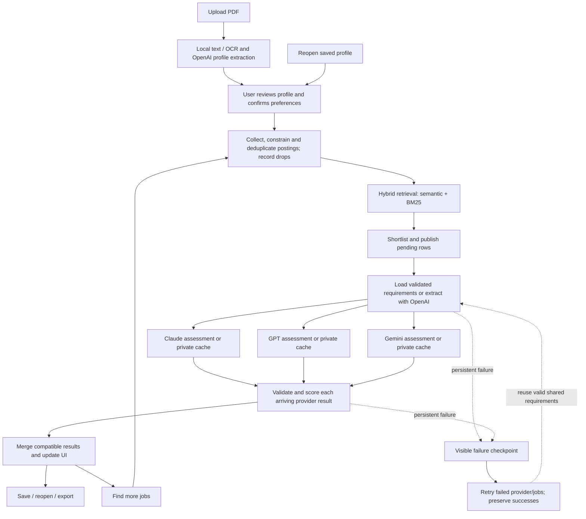

# Career Tracker: workflow and technical guide

Verified against the repository code on **29 October 2026**.

This guide explains the web application's main workflow, the components behind
it, the data they exchange, and the decisions that affect the result. The CLI has
an explicit provider selector; the normal web workflow evaluates with every
available provider (all three unless one fails the pre-search availability check). Configuration defaults below describe the code, not a guarantee of
provider availability or this machine's environment overrides.

Quick navigation:

- [Architecture](#2-the-architecture-in-plain-language) and [upload](#3-upload-and-extract-a-candidate-profile)
- [Collection](#5-collect-jobs-and-build-an-eligible-pool) and [ranking](#6-index-and-rank-jobs)
- [Shared requirements](#7-extract-and-freeze-shared-requirements), [providers](#8-assess-with-claude-gpt-and-gemini), and [scoring](#9-validate-evidence-and-compute-the-fit-score)
- [Failures and retries](#11-failures-retries-and-cancellation), [storage](#12-storage-and-cache-boundaries), and [API routes](#13-main-http-interactions)
- [Evaluating matching quality](#16-evaluate-matching-quality)

## 1. Start with the animated flowchart

- [Interactive animated flowchart](images/application-workflow-flowchart.html): open in a browser, then use Play/Pause, previous/next, the slider, or click a box. On a small screen, scroll the diagram horizontally.
- [Shareable animated GIF](images/application-workflow-flowchart.gif).

Solid arrows show normal processing. Dashed amber arrows show recovery or another
search. Green boxes and moving dots highlight the current explanatory stage.
The animation is a conceptual model, not a live recording or latency benchmark.

After shortlisting, the diagram describes **one posting's path**. Other postings
may be at different stages at the same time. There is no global requirement that
every job finish extraction before any job can be assessed. Provider results are
validated and published as they arrive, without waiting for the whole batch.



Upload failures stop before workspace creation. An empty collected pool finishes
without evaluation. Failed board searches have their own **Retry scraping** path
back to collection. These exceptions are explained below rather than adding every
edge to the main diagram.

## 2. The architecture in plain language

| Component | Responsibility | Main files |
| --- | --- | --- |
| Vue + TypeScript | Upload/review screens, preferences, results and job actions | `frontend/src/` |
| Pinia store | Keep the browser synchronized with the current run | `frontend/src/stores/pipeline.ts` |
| FastAPI routes | Validate HTTP requests and dispatch to handlers | `backend/app.py`, `backend/routers/` |
| Profile service | Read PDFs, extract profiles, save and reopen profiles | `backend/profiles/` |
| Search service | Collect jobs, apply constraints, index and retrieve | `backend/search/` |
| Evaluation service | Share requirements, run providers, validate, score and retry | `backend/evaluation/` |
| Runtime state | Coordinate active workers, cancellation, snapshots and retention | `backend/runs.py`, `backend/runs_api.py` |
| Schema models | Define allowed request, response, profile and assessment shapes | `backend/schemas/` |

`run_app.sh` launches FastAPI on `127.0.0.1:5000` and Vite on `localhost:5173`.
Vite proxies `/api` requests to FastAPI. The launcher no longer opens a browser
tab automatically. Use one Uvicorn worker: active run state and coordination locks
are held in that process. This restriction does __not__ mean evaluation requests
are sequential; thread pools still overlap provider calls inside the process.

Routes are thin adapters. For example:

```text
POST /api/resumes/upload
  → backend/routers/uploads.py
  → backend/profiles/upload.py
  → local PDF extraction + OpenAI classification/profile extraction
  → create and persist the workspace after successful extraction
```

The optional Sheets integration and optional tracing are not required steps in
the user workflow. No service in this diagram automatically applies to jobs.

## 3. Upload and extract a candidate profile

**Input:** a PDF resume. **Output:** a structured profile and workspace/run ID.

The upload handler checks the filename, content type, PDF signature and content.
The code accepts up to 5 MB and 1–20 pages, and rejects unreadable/encrypted or
oversized-page PDFs. Local extraction reads text; OCR supports scanned documents.
OpenAI receives the extracted text to classify the document and produce a profile.

The current upload path combines classification and extraction into one logical
structured request. SDK retries can still mean more than one HTTP call. The upload
request waits for extraction; it does not return a placeholder ID while an
untracked extraction thread continues.

A successful response uses HTTP 201. Invalid documents can return 400, 413 or 422,
depending on the failed check; provider/extraction verification failures return
503. Rejected documents and failed classification do not create a saved workspace
PDF. Temporary extraction resources are cleaned up.

The profile is an interpretation of the resume and can contain mistakes. The user
therefore reviews it before searching. Academic study and personal projects do
not count as professional employment years in the documented experience rules.

The profile includes **projects** (personal, academic or work), each as
`Project | Context | Dates | Description`, editable on the profile page. They
reach the assessment context as a `Projects:` line, so the models can quote them
as evidence for skill requirements; they never add to professional years.
Profiles saved before 29 October 2026 have no projects until the resume is
uploaded again or projects are added by hand.

Source: [upload.py](../backend/profiles/upload.py),
[extraction.py](../backend/profiles/extraction.py).

## 4. Review the profile and confirm preferences

The user checks or edits the candidate profile and chooses target roles, locations,
boards, work arrangement, exclusions, seniority and shortlist size. Confirmation
starts the search worker. Uploading alone does not search job boards.

A saved profile keeps the resume and extracted profile independently of a temporary
run. Reopening it can recover an existing linked workspace rather than extracting
the PDF again. Reopening does not automatically begin a new search. Where available,
an assessment journal can restore missing history without replacing existing rows.

`top_k` controls the shortlist: it does not set how many jobs each board collects.
`top_k=0` means all retrieved jobs. Automatic seniority prioritizes compatible titles
during ranking (see section 6); explicit seniority selection can filter the
collected pool.

Source: [search/service.py](../backend/search/service.py),
[profiles/service.py](../backend/profiles/service.py).

## 5. Collect jobs and build an eligible pool

**Input:** confirmed preferences. **Output:** unique postings with available text.

The default board collection uses JobSpy for supported boards and a dedicated SEEK
path. A configured Adzuna alternative also exists. Only selected sources are
searched. The collector uses small batches and expands sources that return useful,
eligible, unique jobs.

Default adaptive limits are 12 search batches, 60 fallback description fetches,
150 eligible candidates and a 120-second soft deadline. A soft deadline prevents
new work after the budget is reached; it does not guarantee an already-running
network call finishes within that time. JobSpy's own description requests are
outside the fallback-fetch counter.

Collection and subsequent screening handle location/date constraints, requested
filters and duplicates. Work-arrangement, title/company exclusions and explicit
seniority constraints can remove jobs before retrieval. Cross-board duplicate
checks combine identities and description similarity; these remain heuristics.

Each search also records what ingestion drops, for evaluation only. Every posting
removed by location, posting age, a search filter, a missing description, the
collection limits or deduplication is counted by stage, reason and board in
`ingestion.json` in the run folder, with a bounded sample stored for review (up to
120 filtered, 60 description, 60 limit and 50 duplicate postings; descriptions
truncated to 6,000 characters). Jobs already in the workspace are counted only.
Recording observes the existing filters through
[`ingestion_log.py`](../backend/search/ingestion_log.py) and changes no eligibility
decision. A search served from the collection cache records no drops and is
marked incomplete.

A board failure is recorded while other sources can continue. If no jobs remain,
the flow ends without extraction or evaluation. **Retry scraping** reuses confirmed
preferences and targets failed sources, retaining existing results. Availability of
a collected posting is not independently verified.

Source: [collection.py](../backend/search/collection.py),
[adaptive.py](../backend/search/adaptive.py),
[filters.py](../backend/search/filters.py),
[ingestion_log.py](../backend/search/ingestion_log.py),
[provider guide](job-search-providers.md).

## 6. Index and rank jobs

**Input:** eligible postings and candidate search context. **Output:** a shortlist.

An embedding is a numeric representation of text used to compare meaning. The
application uses OpenAI `text-embedding-3-small` for the posting-vector path and
Chroma to store/search shared public posting versions. Unchanged posting vectors
can be reused. Each search keeps its own eligibility scope so it does not suddenly
retrieve every job ever added to the shared index.

Retrieval creates queries from selected roles, skill groups and resume entries. Roles
get half a vote and hard skills and experience one vote each; each family's vote is
split among its queries by evidence, and all weights are then scaled to sum to 1
(roles 20%, skills 40%, experience 40%):

- **Entry evidence:** extraction writes, for each work, section and education entry,
  its type (job, internship, project, hackathon, education), end date, a one-sentence
  posting-style summary without names, dates or figures, and the hard and soft
  skills it states or shows through a described action. An entry edited after
  extraction no longer matches its evidence and falls back to its own words.
- **Entry strength:** recency × type. Recency is 1.0 (ended within a year or
  ongoing), 0.6 (2–3 years or undated) or 0.3 (older), from the extracted end date
  or else the latest year in the entry. Type is job 1.0, internship and project 0.8,
  hackathon and education 0.6, other 0.8; entries without a type count 1.0.
- **Skill groups:** extraction places each technical skill in one group of related
  work and writes one 15–35 word job-ad sentence for it, naming mainstream tools and
  describing niche models by category ("U-Net" becomes "image segmentation models").
  A listed skill scores 0.5
  plus the strength of each entry that uses it, ×1.5 when a target role names it.
  Skills no entry uses and no role names are dropped, so off-target skills do not
  pull in unrelated jobs (all are kept when no entry uses any). Each remaining group
  is one query, its sentence when no skill was dropped and "Group: skills"
  otherwise. A group's share is the average of its kept skills' scores, so a long
  list of weakly used skills does not outweigh a short, strongly proven one.
- **Keyword queries:** extraction also writes one or two lines of 6–12 skill terms
  for exact matching. Each line shares the skills vote with the groups, also at the
  average score of the kept skills it names; a line
  naming no kept skill is not searched. Profiles extracted before this field have
  none.
- **Skill names:** an entry shows a skill when it contains every word of one of the
  skill's names, in any order, after light stemming ("scripts" and "scripting" are
  "script", "APIs" is "API"). Names come from the listed text: level words such as
  "basics" are ignored ("Docker (basics)" is Docker, and queries show it as Docker),
  parentheses add names ("Flutter (Dart)", "(RAG)"), comma lists split ("Claude, GPT
  and Gemini"), and each side of "Git/GitHub" counts. "ExpressJS", "Express.js" and
  a bare "Express" in an entry match each other; "expressed" does not.
- **Soft skills:** not searched by default (zero votes), because most postings ask
  for communication and teamwork; they still inform the fit assessment. Given a
  vote through `RETRIEVAL_WEIGHTS`, they form one query of the soft skills that
  entries show, strongest first, or the listed ones when no entry shows any.
- **Experience:** each entry is its own query (its summary and hard skills when
  extracted, otherwise the entry text), weighted by strength × relevance (skills
  and role words it mentions, full at 3 matches, floor 0.25). Role words exclude
  seniority words (from the seniority filter's patterns) and words found in more
  than half of the entries (and in at least 3). The top 8 are kept.

All of these numbers are defaults in `DEFAULT_RETRIEVAL_WEIGHTS`
([ranking.py](../backend/search/ranking.py)). `RETRIEVAL_WEIGHTS`, a JSON object in
the environment, overrides any of them; nested keys merge, and invalid JSON or an
unknown key stops retrieval with an error rather than running on silent defaults.

`QUERY_BUILDER=skills` keeps the roles and skill groups but drops the
experience queries: entries only weight the skills they use, so a posting that asks
for some of the candidate's skills matches without the domain words of the entry
where they were used. Skills an entry shows but the skill list omits join the
skill queries, in the group whose skills the same entries use most, or "Other
skills" when they share none. Skills no entry shows are kept at a low score
(`listed_only`, 0.2, instead of 0.5 plus entry strength), so they are searched but
rank below proven skills. `QUERY_BUILDER=legacy` restores the previous builder (one
query per role, all skills as one query, recent work, and other sections together).
`QUERY_BUILDER=hyde`, the default since 12 November 2026 for searches and the
playground, is `evidence` with the role titles replaced by up to three
model-written job ads ([hyde.py](../backend/search/hyde.py)), sharing the role vote
0.4 / 0.35 / 0.25. They are written from the target roles, the eight strongest kept
skills, the two strongest entries and the profile's career level and years, with no
other skills and no more years than the candidate has; an ad stating more years
(or any years when tenure is unknown) is dropped. Ads are searched densely only,
because their posting boilerplate would skew BM25, and are cached in
`.cache/hyde_queries` by prompt. If generation fails, the role titles are used and
the failure is not retried for five minutes, so a search's queries and weights agree.
An unknown value stops retrieval with an error. The retrieval playground picks the
builder per run (its Queries select, `query_builder` in the request) and ignores this setting.
`python -m scripts.compare_query_builders <run_id>` replays a saved run under
all four builders and prints each one's queries, top jobs, off-target title counts
and how many top jobs the legacy and skills builders share with evidence.
It embeds the queries with OpenAI and prints private run data, so keep its output local.

Each query contributes two rankings:

- **Semantic ranking:** similarity of embedding vectors.
- **BM25 ranking:** lexical relevance based on words and their distribution.

**Reciprocal rank fusion (RRF)** combines positions rather than pretending the two
ranking scores have the same units. With constant 60, a ranking contributes
`weight / (60 + rank)` to a candidate's combined ordering. Role, skill and
recent-work query groups are balanced by the configured query weights.

Before shortlist selection, explicit dismissal preferences can move matching jobs
below other retrieved jobs while preserving relevance order within each group.
Automatic early-career title prioritization remains primary. This is owner-scoped
preference ordering, not provider training; see [dismissal preferences](dismissal-preferences.md).

The resulting ranking is a way to choose what to assess. It is not the final fit
score or a hiring probability. For an early-career profile (graduate, entry or
junior level, or two years or fewer of experience), automatic seniority moves
some experienced-level titles below the others before top-K selection:

- Graduate/entry/junior profiles: any mid-level, intermediate, senior, lead,
  staff, principal, director, head-of, chief or architect title, unless the title
  also accepts juniors.
- Profiles that are early-career only by years (career level mid or unknown):
  such a title moves down only when the posting states more years of experience
  than the profile records, or the title is director, head-of or chief.

Stated years count only when phrased as a requirement (for example "5+ years",
"minimum of 3 years", "3–5 years of experience"), not company age. Moved jobs stay
in the pool and can fill spare shortlist slots.

The shortlist is published as **pending result rows** before remote assessments
finish. This is why jobs can appear before their scores do.

Source: [ranking.py](../backend/search/ranking.py),
[retrieval.py](../backend/search/retrieval.py),
[shared_index.py](../backend/search/shared_index.py),
[matching guide](matching-improvements.md).

## 7. Extract and freeze shared requirements

**Input:** posting text only, with no candidate resume. **Output:** a `RequirementSet`.

This stage gives the providers a common set of questions. Without it, independent
models could invent different denominators by assessing different requirements.

The current extraction policy is `requirements-v5`:

1. Number the original posting lines.
2. Ask OpenAI for structured requirements with inclusive `source_start` and
   `source_end` line references. Strict JSON-schema enforcement is explicitly enabled.
3. Validate the schema and bounds. Reject reversed, nonexistent or blank-only ranges.
4. Copy selected text from the __original posting__ into `job_quote`. The model does
   not reproduce the quote itself.
5. Validate nonempty criteria, quote provenance and duplicate criteria. Clear an
   unsupported optional section label instead of blocking an otherwise valid quote.
6. Assign stable source-ordered IDs such as `req_001` and freeze the shared list.

A persisted criterion contains `requirement_id`, `requirement`, `importance`,
`job_quote`, `section` and `type`. Importance is `must_have`, `nice_to_have` or
`unclear`; types distinguish skills, experience, education, eligibility,
responsibilities and other criteria. Source coordinates are extraction inputs,
not extra fields in the saved criterion.

Concurrent providers share one loader result per posting, including a shared
extraction failure. Valid public-cache hits skip the extraction call. Invalid
output receives one automatic correction retry. A persistent failure blocks that
posting's assessments; the system does not silently let each provider invent its
own list.

Line references guarantee where the quote came from. They do not prove that the
model summarized it correctly, classified importance correctly, or found every
requirement. A single-line posting may produce a broad quote. Frozen historical
lists are validated and retained rather than silently rewritten.

Source: [requirements.py](../backend/evaluation/requirements.py),
[evaluation schemas](../backend/schemas/evaluation.py).

## 8. Assess with Claude, GPT and Gemini

Before evaluation, one tiny request checks each provider. A provider whose quota or
spend cap is exhausted, whose credentials are rejected, or whose model is unavailable
is skipped, listed under "Some models were skipped" and saved for a targeted retry; see
[EVALUATION_MODELS.md](EVALUATION_MODELS.md). Each provider receives the same frozen criteria plus candidate context, posting
and selected roles. Each must return exactly one verdict for each requirement ID
and preserve its canonical fields. It cannot add, drop, split, merge or reclassify
requirements. Copied fields are compared after Unicode normalization, whitespace
collapsing and straightening curly quotes and dashes, because a posting can contain
characters such as non-breaking spaces that a model cannot reproduce. The saved
verdict always keeps the shared wording exactly; any real rewording is rejected. Verdicts are `met`, `partial`, `not_met` or `unknown`, with resume
quotes and explanations.

The three provider batches run concurrently. Each advances independently in waves
of 15 and uses its own per-job concurrency. One provider's negative verdict never
skips another provider. Provider-tagged retries run only the failed provider/job.

| Setting | Default in code |
| --- | --- |
| Requirement extractor | `gpt-4o-mini`; override `REQUIREMENT_EXTRACTION_MODEL` |
| Resume upload | `OPENAI_UPLOAD_MODEL`, otherwise profile model default `gpt-6.1-sol` (low reasoning effort) |
| Claude evaluator | `claude-sonnet-5-5` |
| GPT evaluator | `gpt-6.1-sol` |
| Gemini evaluator | `gemini-4-argon` |
| Concurrent jobs per provider | Claude 4, GPT 4, Gemini 2; configured counts capped at 8 |
| Extraction timeout | 90 seconds per request |
| Evaluation timeout | Claude/Gemini 90 seconds; GPT 180 seconds by default |
| GPT timeout override | `GPT_EVALUATION_TIMEOUT_SECONDS`, clamped to 30–600 |
| Gemini proactive RPM | 0 by default; pacing can be enabled, backoff still applies |
| Claude output limit | 8,192 tokens |

GPT's configured default uses low reasoning; Gemini's configured default uses low
thinking. These options apply to the supported model IDs in code, not arbitrary
overrides. Environment overrides can change actual runtime choices.

OpenAI uses native JSON-schema dictionaries with `strict=True`, followed by local
Pydantic validation. This avoids the SDK typed-`parsed` serialization path that
previously warned about a `JobEvaluation` value. Claude's raw response envelope is
checked for parsing failures and output truncation. No provider is silently
substituted when another fails.

Source: [providers.py](../backend/evaluation/providers.py),
[orchestration.py](../backend/evaluation/orchestration.py),
[provider configuration guide](EVALUATION_MODELS.md).

## 9. Validate evidence; the model decides the fit

Since 30 October 2026 each model's own `fit_category` is the assessment's result
(`score_method` `model-decision-v1`); models return no numeric score, and a model
that sets aside a seniority rule must say why in `rule_exception`. The rubric and guards
below still run on the same assessment, but only to save `rubric_score`,
`rubric_category` and `rubric_reason` for comparison against human labels; they
no longer change the verdict.

The backend first checks schema validity, exact shared IDs and unchanged canonical
fields (compared as described in section 8). It then verifies job and resume quotes against their source text, ignoring
case and whitespace. Missing or invalid evidence becomes **unknown** rather than
a proven inability. Only criteria with verified job evidence enter the score's
denominator.

The comparison rubric is computed as follows.

| Importance | Weight | Verdict | Credit |
| --- | ---: | --- | ---: |
| Mandatory | 2 | Met | 1 |
| Preferred | 1 | Partial | 0.5 |
| Unclear | 1 | Unknown or not met | 0 |

The importance and verdict columns are separate lookup tables: every criterion
uses one importance weight and one verdict credit.

```text
raw score = round(100 × Σ(weight × credit) / Σ(weight))
```

For example, one mandatory criterion met and one preferred criterion partial
produce `100 × (2×1 + 1×0.5) / 3 ≈ 83`. That number alone is insufficient for a
strong recommendation; the category and experience rules still apply.

- When the resume does not mention a requirement, the verdict is `not_met` with an
   empty resume quote. It earns no credit but cannot reject the job on its own.
   Only a `not_met` with a verified resume quote that shows the gap (for example
   two years against a stated minimum of five) is an evidenced mismatch.
- An evidenced mandatory mismatch excludes the job and caps the score at 39.
- The requirement rubric allows strong match only with mandatory criteria present
   and all met, no unclear importance, verified job evidence and score at least 80.
- Otherwise, the rubric keeps the job for review and caps the score at 79.
- No usable verified job evidence produces no score.
- Additional professional-experience and seniority guards can exclude a job or
   require review. A strong result also needs experience alignment to be met.
   The seniority guard follows the section 6 rule: graduate/entry/junior profiles
   are excluded from experienced-level titles; other early-career-by-years profiles
   only when the posting states more years or the title is executive. The evaluator
   instructions apply the same distinction.

A separate mandatory-years field cannot turn a preferred requirement into a hard
prerequisite. If `minimum_professional_years` is supplied, its evidence must be
supported by a shared `must_have` quote. Otherwise the model must correct its
claim; when there is no explicit supported minimum, it must use null and empty
evidence. The application does not bypass that guard simply to make a retry pass.

These are explicit policy rules, not calibrated hiring probabilities. Passing
software tests does not establish matching accuracy on human-labeled cases.

Source: [evidence.py](../backend/evaluation/evidence.py),
[candidate_fit.py](../backend/evaluation/candidate_fit.py),
[requirements.py](../backend/evaluation/requirements.py).

## 10. Combine results and update the interface

The orchestrator merges completed provider results into the pending job row.
Combination is allowed only when completed assessments use compatible requirement
lists. An old assessment and a new-list assessment must not silently produce a
misleading shared score.

- A **final score** requires three completed, comparable assessments with numeric
   scores, and is their rounded average.
- At least two available comparable scores may produce a **provisional average**
   while the full set is incomplete. It is labeled as provisional.
- A final category requires every evaluated model's completed assessment to agree. Otherwise,
   the combined category is **For review**.
- Completion counts and agreement counts are shown separately. Agreement does not
   measure confidence or establish correctness.

The frontend uses **server-sent events (SSE)** for progress and snapshot polling as
a recovery path. SSE is a one-way stream from server to browser. Polling means the
browser periodically asks for the latest complete state; it repairs missed events
or a disconnected stream. Reading or refreshing a snapshot does not rerun failed
model calls.

Source: [orchestration.py](../backend/evaluation/orchestration.py),
[pipeline.ts](../frontend/src/stores/pipeline.ts).

## 11. Failures, retries and cancellation

| Failure | What happens | Recovery |
| --- | --- | --- |
| Invalid PDF or failed classification | No workspace PDF is created | Correct the upload or resolve provider failure |
| A board fails | Other sources can continue; source error is retained | Retry scraping |
| Extraction schema or source range is invalid | One correction retry; persistent failure blocks posting assessments | Retry failed evaluations |
| Shared IDs, fields or mandatory evidence are inconsistent | One correction retry for that assessment; the note names the requirement ID and field | Retry failed provider/job |
| Provider rate limit | Pacing/backoff and provider policy apply | Retry after quota/cooldown permits |
| Permanent quota, credentials or model access failure | Affected provider submissions stop/skip under its policy | Fix configuration or quota before retrying |
| Cancel requested | Later work and late persistence are blocked | Existing completed results remain available |

There are separate retry layers: an SDK may retry transport failures, the
application retries invalid output once, and a user can explicitly retry saved
failures. One logical extraction or evaluation is therefore not necessarily one
HTTP request. Cancellation cannot instantly interrupt an already-running remote
request.

Safe validation errors identify schema-defined nested fields, array indices and
controlled error descriptions. They exclude returned values and arbitrary extra
keys. Retry prompts receive that feedback so they can correct the response.
Retries preserve successes, reuse valid frozen requirements and do not switch
providers silently. While a retry runs, the stepper and run page show its own
progress (`retry_total` / `retry_done` on the run), not the search-wide counters.
The results page groups failed assessments by model and reason with job counts.

If an old error still appears after a code fix, restarting loads the new backend
code but does not erase historical errors. Use the failed-evaluation action to
actually recompute failed work. Do not delete saved data or all caches as a routine
repair step.

Source: [runtime.py](../backend/evaluation/runtime.py),
[structured_output.py](../backend/evaluation/structured_output.py),
[evaluation/service.py](../backend/evaluation/service.py),
[runs.py](../backend/runs.py).

## 12. Storage and cache boundaries

Persistence occurs throughout the workflow. The final save box in the diagram
represents user actions and revisiting work, not a claim that nothing was saved
earlier.

| Location | Contents and purpose | Reuse / lifecycle |
| --- | --- | --- |
| `frontend/runs/<id>/` | Run snapshots, resume/context, assessment journal, failed-job checkpoints, exports and search-specific artifacts | Written only once the first search starts or the profile is saved (an unsearched upload stays in memory); then seven-day run retention; cancellation/deletion respects active workers |
| `frontend/runs/<id>/ingestion.json` | Per-search drop counts and a bounded sample of dropped postings | Removed with the run; never sent in live search snapshots |
| `data/profiles/` | Saved profile metadata and separately stored resume/context | Managed separately from temporary run expiry |
| Run or saved-profile `evaluations/` | Private structured assessments with candidate evidence | Seven days; bounded to 1,000 entries per owner |
| `.cache/job_requirements/` | Validated public posting requirements; no candidate context | Seven days; at most 1,000 entries |
| `.cache/job_collections/` | Collected public postings keyed by search parameters | Default 15 minutes; bounded cache |
| `.cache/job_descriptions/`, `.cache/linkedin_descriptions/` | Reusable public posting descriptions | Provider-specific description-cache policy |
| `.cache/job_index/` | Shared versioned public posting vectors | Shared index maintenance policy; per-search eligibility scopes |
| `.cache/job_embeddings/` | Content-addressed public text vectors | Default 30-day vector reuse; candidate query vectors are not cached here |
| `.cache/hyde_queries/` | Model-written job ads for the `hyde` query builder, keyed by prompt | Reused until the profile, roles or prompt change; no expiry |
| `data/evaluation_datasets/<id>/` | Labeled dataset synced from Applied/Dismiss actions (`dataset.json`, `reviews.json`); one per saved profile or run | Not removed with the run or profile; delete by hand |
| Browser localStorage | Job-action flags such as Save/Dismiss/Applied; playground relevance marks | Browser-local persistence; saved-profile actions also integrate with server storage |

Requirement-cache identity includes posting content, extraction model, prompt,
schema and policy version. Private assessment identity additionally includes
candidate context/profile, roles, provider/model and assessment policy/settings.
Changing relevant inputs creates a different key. Failed or cancelled assessments
are not cached as successes. Cache hits are rechecked by current validation paths.

Saved-profile deletion and temporary-run deletion have separate responsibilities.
The application currently has no user accounts or account isolation: saved
profiles are server-wide and run URLs should be treated as private.

Source: [paths.py](../backend/paths.py), [cache.py](../backend/evaluation/cache.py),
[storage.py](../backend/profiles/storage.py), [runs.py](../backend/runs.py),
[shared index guide](shared-job-index.md).

## 13. Main HTTP interactions

The table lists current web routes, not every compatibility alias. `run_id` is the
workspace identifier used to read state, follow progress or retry work.

| Method and path | Purpose |
| --- | --- |
| `POST /api/resumes/upload` | Upload, classify and extract a resume; create workspace on success |
| `POST /api/playground/upload`, `POST /api/playground/ingestion`, `POST /api/playground/retrieval` | Run the upload, ingestion or retrieval stage on its own; nothing is saved |
| `PUT /api/searches/{run_id}/confirm-profile` | Confirm profile/preferences and start searching |
| `GET /api/searches/{run_id}` | Read the authoritative snapshot; does not start work |
| `GET /api/searches/{run_id}/progress` | Stream progress events |
| `POST /api/searches/{run_id}/find-jobs` | Start collection/evaluation from supported form inputs |
| `POST /api/searches/{run_id}/find-more` | Append newly found jobs using revised preferences |
| `POST /api/searches/{run_id}/retry-scraping` | Retry failed board sources |
| `POST /api/searches/{run_id}/retry-evaluations` | Retry failed provider/job checkpoints |
| `POST /api/searches/{run_id}/cancel` | Request cancellation |
| `GET /api/searches/{run_id}/exports/{file_name}` | Download an allowed export |
| `GET/PUT /api/searches/{run_id}/actions` | Read/update flags and optional dismissal feedback |
| `POST /api/searches/{run_id}/tailored-resume` | Generate a tailored resume for one job (`{key}`) and save it on that job |
| `DELETE /api/searches/{run_id}` | Delete a run, deferring removal while active |
| `GET/POST /api/profiles` | List/save profiles |
| `PUT/DELETE /api/profiles/{profile_id}` | Update/delete a saved profile |
| `POST /api/profiles/{profile_id}/searches` | Reopen linked workspace; `fresh=true` creates a new one without automatically searching |

FastAPI's `/docs` and the generated OpenAPI file describe the exact request and
response fields. Python schema models are authoritative; generated frontend types
are regenerated from them rather than manually edited. Historical `/api/runs`
aliases remain for supported compatibility paths.

Source: [routers](../backend/routers/),
[OpenAPI export](../frontend/openapi.json).

## 14. Find more jobs, export and revisit

**Find more jobs** is a loop back to collection. It forces fresh collection,
filters previously seen postings and adds the new shortlist to the same workspace.
The selected shortlist size applies to the **new batch**, not the total combined
results. Existing assessments and job-action flags remain.

Each search records its time, boards, roles and locations (`searches` on the run).
The Find more form names boards, roles or locations not searched before; if none
are new and the last search was under an hour ago, it notes that results may
mostly repeat. It never blocks the search. The finished message reports how many
postings were skipped because they are already in the results.

Once a workspace contains assessments, confirming a changed candidate profile is
rejected with HTTP 409; create a new search for a changed profile so existing
assessments are not silently mixed with a different candidate context.

Exports provide data for manual review. Save, Dismiss and Applied track user
choices; Applied is a tracking flag, not proof that the application submitted
anything. Deleting/expiring a temporary run does not automatically delete its
independently saved profile.

Each action update also syncs a labeled dataset under `data/evaluation_datasets/`
(one per saved profile, else per run): Applied is labeled a strong match; Dismiss
for role or seniority is not suitable; location, salary, other or no reason keeps
the action and reason but no fit label. Undoing an action removes its label, and
hand-written labels are never overwritten. A dataset error is logged after the
action is saved, so it never blocks the action. Source:
[action_dataset.py](../backend/evaluation/action_dataset.py).

A job's **Tailored resume** tab calls Claude (`CLAUDE_EVALUATION_MODEL`) with a strict
JSON schema to select, order and reword the uploaded resume for that posting; the
prompt forbids new facts. Afterwards, skills and figures not found in the resume
text are listed as unverified, and requirements the resume does not show are listed
apart from the resume. The model call runs outside the run lock; the result is saved
as `tailored_resume` on the job's row and kept through retries. Sections follow the
UNSW Employability resume guide in a single-column, ATS-friendly layout; Download PDF
prints only the sheet. Source: [tailoring.py](../backend/profiles/tailoring.py),
[TailoredResume.vue](../frontend/src/components/TailoredResume.vue).

## 15. Observability, verification and limits

Optional LangSmith tracing records stage timing, counts and safe failure
categories. It is designed not to export resume or posting text. See
[tracing setup](langsmith-tracing.md) for the exact configuration and coverage.

For application changes, `./scripts/check.sh` runs Python regressions, contract
generation, frontend tests, type checking and a production build. It uses the
`job-tracker` conda environment when present (or `PYTHON_BIN`) and stops early if
project dependencies are missing. Add `--e2e` for
affected browser workflows. Mocked providers verify software behavior, not live
availability or human matching accuracy.

For this documentation task, the flowchart is checked in a real headless browser
for rendering, controls, keyboard node selection and mobile scrolling. Local
source links are checked. The animation uses no real candidate or posting data
and makes no provider requests.

Remaining limits include unverified vacancy availability, incomplete or ambiguous
job descriptions, potentially missed retrieval matches and model interpretation
errors. Shared extraction makes criteria consistent across providers, but also
shares any extraction mistake. Human-labeled evaluation remains necessary to
measure relevance, missed matches and strong-match precision.

## 16. Pipeline playground

`/eval` is the pipeline playground: run one stage on its own and inspect its output.
**Upload** reads a PDF into a profile exactly as an upload does (one OpenAI call) and
checks it against the resume's own text. **Ingestion** searches the selected boards
live, bypassing the collection cache, and lists kept and dropped jobs with reasons.
**Retrieval** ranks the Ingestion tab's kept jobs against the Upload tab's profile
with the same queries, weights and fusion as a search, in a throwaway index (OpenAI
embeddings unless cached), and shows the queries and the ranked shortlist. Runs are never saved and never touch searches. The tab is kept in the URL as
`?stage=upload|ingestion|retrieval`.

On the Retrieval tab, each shortlisted job can be marked Relevant or Not relevant.
The marks stay in the browser (`playground-relevance-marks`) and feed Recall@15/50/100
and @shortlist, rank-aware context precision, context relevance and marking coverage.
Unmarked jobs count as unknown, never as misses, so these numbers describe only the
marked jobs. Source: [retrievalMetrics.ts](../frontend/src/utils/retrievalMetrics.ts).

Source: [playground.py](../backend/routers/playground.py),
[upload_check.py](../backend/evaluation/upload_check.py),
[EvalView.vue](../frontend/src/views/EvalView.vue).
